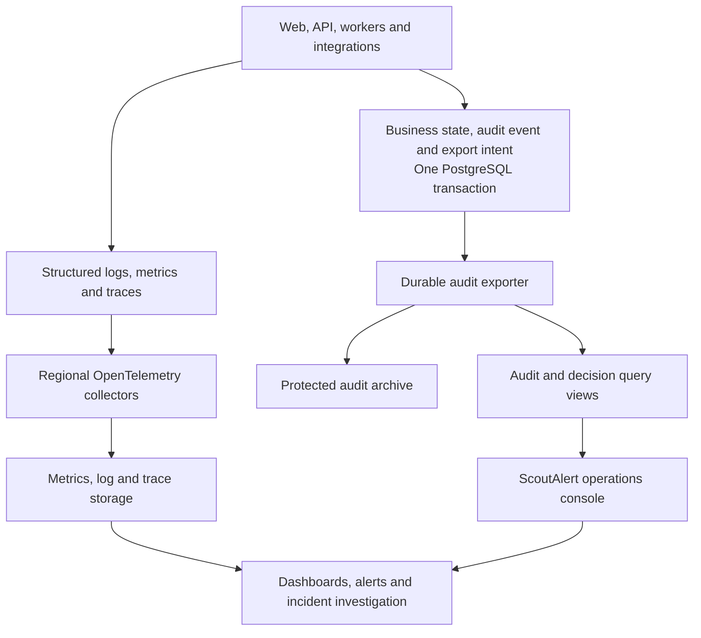

# ScoutAlert monitoring and audit architecture

**Version:** 0.1

**Date:** 4 October 2026

**Status:** Target design for implementation planning. This document does not establish deployed monitoring, completed audit coverage, or production readiness.

**Scope:** The full platform and its planned capabilities, including internet discovery, personal scouting, investigation, recommendations, delivery, pursuit, learning, commercial operations, and administration.

**Acceptance:** [Monitoring and audit acceptance gates](../engineering/scoutalert-observability-acceptance.md)

## Purpose and governing requirement

ScoutAlert needs to explain every consequential action from a person's confirmed goal through discovery, assessment, notification, and feedback. Operational health, business history, evidence, quality, and spending must be connected without exposing private information or making diagnostic storage an authority for business state.

The governing requirement is:

> Every important operation has an identity, every consequential decision has a recorded reason, every external effect has an outcome or an explicit unresolved state, and every unfinished operation remains visible until resolved.

Coverage includes actions that did not happen: denied access, deferred searches, inaccessible sources, rejected candidates, unresolved research, superseded work, and suppressed notifications. A completed workflow or healthy HTTP endpoint alone does not demonstrate a successful Scout.

Complete coverage means accounting for declared consequential operations at controlled system boundaries. It does not mean storing every debug statement, raw prompt, private input, or browser interaction indefinitely. Critical audit events are durable and unsampled; routine diagnostics have bounded volume and retention. Gaps, lost diagnostic data, and unavailable external evidence remain explicit.

The [platform PRD](../prd/scoutalert-platform-prd.md) owns product scope. The [platform architecture](scoutalert-platform-architecture-v0.1.md) owns business boundaries, while the [discovery architecture](scoutalert-discovery-architecture.md) owns discovery mechanics. This document owns monitoring, audit guarantees, correlation, operational investigation, and their implementation sequence.

## Current code baseline

These findings describe the repository inspected on 3 October and rechecked for documentation on 4 October 2026. They are source-level findings, not new live-provider tests or production measurements.

| Area                  | Existing foundation                                                                                                                                                                                                                                                                                | Remaining architecture work                                                                                                                                                     |
| --------------------- | -------------------------------------------------------------------------------------------------------------------------------------------------------------------------------------------------------------------------------------------------------------------------------------------------- | ------------------------------------------------------------------------------------------------------------------------------------------------------------------------------- |
| API observation       | [Nest Observe registration](../../apps/api/src/app.module.ts) is conditional on credentials; HTTP capture is disabled.                                                                                                                                                                             | Establish shared context, safe structured errors, and cross-process correlation. Configuration in code does not establish that observation is enabled in a deployment.          |
| Web request handling  | [Server API client](../../apps/web/server/api-client/scout-api.ts) maps upstream failures to safe user-facing states.                                                                                                                                                                              | Retain internal error classification and request correlation without exposing private payloads. Add browser/server instrumentation.                                             |
| Worker execution      | [Worker composition](../../apps/worker/src/main.ts) creates eight logical queues with independent concurrency settings in one Node process.                                                                                                                                                        | Measure queue age, progress, retries, saturation, and process failure scope. Separate process placement as operating requirements justify it.                                   |
| Partial discovery     | [Scout workflow](../../packages/workflows/src/scouting/public.ts) can preserve indexed matching when external discovery or review fails.                                                                                                                                                           | Record partial or degraded outcomes independently of workflow completion.                                                                                                       |
| Business receipts     | [Identity and activation migration](../../packages/adapters/src/database/migrations/20260930-identity-and-activation.ts) and [user controls migration](../../packages/adapters/src/database/migrations/20261001-user-controls.ts) include consent, activation, scout-change, and feedback records. | Introduce a consistent journal, actor/action schemas, access controls, retention, and verified exports. Existing records are not a complete immutable audit system.             |
| Discovery and AI      | Provider attempts, observations, review records, usage, and budgets are persisted; [cost estimation](../../packages/adapters/src/scouting/intelligence/usage-cost.ts) records a pricing version and leaves unknown models unpriced.                                                                | Connect public work to private consumption, decision history, cost reconciliation, coverage, and quality dashboards.                                                            |
| Email effects         | [Delivery repository](../../packages/adapters/src/notifications/persistence/postgres-opportunity-delivery.ts) retains submission identities and accepted, rejected, or unknown outcomes.                                                                                                           | Expose reconciliation and suppression reasons; add production provider delivery, bounce, and complaint evidence when supported. SMTP acceptance is not proof of inbox delivery. |
| Health and operations | [API starter route](../../apps/api/src/app.controller.ts) verifies HTTP wiring. The [repository layout](../engineering/scoutalert-repository-layout.md) reserves an observability package.                                                                                                         | Implement appropriate liveness/readiness, an operations console, central dashboards, alerts, and monitoring of telemetry itself.                                                |

Historical implementation evidence retains its original scope. No existing tests or receipts automatically pass the new acceptance gates.

## Five connected capabilities

| Capability                       | Responsibility                                                                                      | Authority                                                              |
| -------------------------------- | --------------------------------------------------------------------------------------------------- | ---------------------------------------------------------------------- |
| Operational monitoring           | Health, latency, errors, capacity, progress, and incidents                                          | Diagnostic measurements; not permission to change business state       |
| Business and security auditing   | Actor, authority, action, resource, outcome, and historical changes                                 | Transactional audit journal and protected exports                      |
| Decision and evidence history    | Why an agent searched, investigated, rejected, ranked, published, or notified                       | Versioned decisions linked to scoped evidence                          |
| Coverage and quality measurement | Useful discovery, missed opportunities on known samples, cohort coverage, freshness, and evaluation | Reproducible datasets, reviewed judgments, and measurement definitions |
| Usage and cost accounting        | Reservations, consumption, estimates, uncertain charges, and reconciliation                         | Durable usage records and provider billing evidence                    |

The capabilities share identifiers and version references. They have different retention, access, and delivery guarantees.

## Runtime topology and recommended stack

| Responsibility                 | Recommended foundation                                            | Adoption boundary                                                                                      |
| ------------------------------ | ----------------------------------------------------------------- | ------------------------------------------------------------------------------------------------------ |
| Runtime instrumentation        | OpenTelemetry                                                     | Initialise in composition roots; keep SDKs outside domain and application code.                        |
| Collection                     | Regional OpenTelemetry Collectors                                 | Bounded queues, durable buffering where configured, redaction, export health, and protected transport. |
| Metrics                        | Prometheus-compatible metrics; Mimir for distributed storage      | Keep dimensions bounded and choose deployment size from measurements.                                  |
| Structured logs                | Loki                                                              | Use safe structured records with event and trace references.                                           |
| Distributed traces             | Tempo                                                             | Trace finite operations and link related executions.                                                   |
| Dashboards and alerting        | Grafana                                                           | Provision versioned dashboards and alert rules.                                                        |
| Browser errors and performance | Grafana Faro or an equivalent integration                         | Exclude form contents and private page content; no default session replay.                             |
| Audit journal                  | PostgreSQL                                                        | Commit required audit records with business state through repositories.                                |
| Audit archive                  | Object storage with verified retention and integrity capabilities | Separate trust/access boundaries; validate the chosen provider's guarantees.                           |
| Business investigation         | ScoutAlert operations console                                     | Permission-scoped queries over audit and decision projections.                                         |

OpenTelemetry provides a provider-independent collection boundary, and the [Grafana stack](https://grafana.com/about/grafana-stack/) supplies compatible metrics, logs, traces, and visualisation. These are recommended target choices; dependencies and deployment are separate implementation work. A managed production deployment is preferred initially to reduce operating burden, subject to cost, residency, access, and recovery requirements.

Existing Nest Observe integration needs an explicit coexistence decision: verify correlation/export behaviour and avoid duplicate instrumentation before keeping it alongside the platform standard. Do not assume an installed integration provides cross-platform coverage.

Collector retry and persistent buffering reduce loss, but queue exhaustion, storage failure, and export deadlines can still lose telemetry. The audit exporter therefore uses durable business records and independently reconciled acknowledgements. [Collector resiliency](https://opentelemetry.io/docs/collector/resiliency/)

Dedicated event streaming, analytical databases, and continuous profiling remain workload-driven additions. They are not prerequisites for the first complete journey.

## Platform coverage contract

Each capability declares its events, metrics, diagnostic spans, data classification, retention, owner, failure states, and acceptance evidence before release. New features extend this contract.

| Surface                                         | Required visibility                                                                                                                                                                          |
| ----------------------------------------------- | -------------------------------------------------------------------------------------------------------------------------------------------------------------------------------------------- |
| Website and onboarding                          | Rendering and route failures, performance, step completion, validation failures, save outcomes, recovery, and accessible error states; exclude typed private content from browser telemetry. |
| Identity and account access                     | Verification outcomes, throttling, session creation/revocation, authorization decisions, abuse signals, and sign-in dependency failures.                                                     |
| Profiles, scouts, and consent                   | Creation, confirmation, edits, pause/resume, archive, ownership, consent, version changes, provenance, and initiating actor.                                                                 |
| API and server routes                           | Request latency, safe error class, validation/guard outcome, dependency timing, cancellation, route template, release, and correlation.                                                      |
| Workflows and dispatch                          | Commit-to-dispatch delay, queue waiting, activity attempts, leases, retry exhaustion, cancellation, supersession, reconciliation, and oldest unfinished work.                                |
| Scout planning                                  | Confirmed goal version, selected routes, priorities, budget admission, exploration allocation, structured decision reasons, and stopping conditions.                                         |
| Search and social providers                     | Capability/access class, public query reference, language/region, coverage window, pagination/cursor, rate limit, completeness, result counts, usage, and failures.                          |
| Feeds, streams, crawling, and inbound discovery | Fetch/parser failures, format drift, reconnect gaps, freshness, source admission, duplicates, and authorised alert/newsletter/community ingestion.                                           |
| Source expansion                                | Candidate origin, validation, admission/rejection, supported categories, registration, refresh policy, measured contribution, and suspension.                                                |
| Opportunities and evidence                      | Origin, canonical identity, variants, revisions, citations, freshness, conflicting claims, deletion, expiry, and dependent invalidation.                                                     |
| Retrieval and indexing                          | Projection lag, candidate counts, filters and exclusions, retrieval/reranker versions, evaluation recall, embedding model/dimension compatibility, and index rollout.                        |
| AI extraction and research                      | Model/prompt/schema versions, evidence references, tool choices, permission checks, validation, unknowns, retries, fallback, timing, tokens, and cost.                                       |
| Matching and recommendations                    | Scout/evidence/assessment versions, hard constraints, conflicts, unknowns, ranking factors, feedback influence, publication, rejection, and invalidation.                                    |
| Notifications                                   | Current consent/eligibility, grouping, quiet hours, limits, deduplication, suppression, submission attempt, ambiguous effects, and provider receipts.                                        |
| Feedback and learning                           | Exposure and ranking context, relevant/hidden/saved actions, reversals, policy changes, independent evaluation, experiments, and training provenance.                                        |
| Opportunity pursuit and assistance              | Private notes, application/engagement stages, draft provenance, explicit action permissions, approvals, and external effects.                                                                |
| Integrations                                    | Connection scope, credential expiry metadata, access failures, revocation, inbound authentication, and propagation of restrictions.                                                          |
| Billing and entitlements                        | Limits, reservations, releases, consumption, plan changes, payment events, idempotency, reconciliation, and disputes when implemented.                                                       |
| Administration and deployments                  | Operator reads/exports/actions, overrides, configuration and budget changes, credential rotation metadata, releases, migrations, and rollback.                                               |
| Infrastructure and recovery                     | PostgreSQL, Redis, Temporal, object storage, compute, networking, certificates, backup success, restore evidence, ownership, and regional recovery.                                          |
| Monitoring and audit infrastructure             | Export lag, queue capacity, dropped diagnostics, unknown event schemas, archive integrity, missing heartbeats, and alert delivery.                                                           |

Planned product surfaces in this table are coverage obligations when implemented, not claims that those features already exist.

## Correlation and event semantics

Every durable event uses a common envelope with a typed, versioned feature payload. Avoid a generic unvalidated JSON bag.

| Field group     | Required meaning                                                                                                  |
| --------------- | ----------------------------------------------------------------------------------------------------------------- |
| Event identity  | Stable event ID, event type, and schema version                                                                   |
| Timing          | Occurred time, recorded time, execution region, and applicable source observation time                            |
| Actor           | Verified user, operator, service, or authenticated provider; claimed browser identity never establishes authority |
| Subject         | Resource kind, resource ID, version, and verified private scope when applicable                                   |
| Causality       | Logical operation ID, initiating event, parent operation, and idempotency identity                                |
| Execution       | Request, workflow ID, workflow execution, activity, attempt, and provider operation references where available    |
| Outcome         | Typed result, reason code, and allowlisted change summary or previous/current version references                  |
| Reproducibility | Code release, configuration, policy, model, prompt, extraction, and schema versions relevant to the decision      |
| Evidence        | Permission-scoped references with source, freshness, and retention metadata                                       |
| Accounting      | Reservation, usage, estimate, reconciliation, currency/unit, and pricing version as applicable                    |
| Diagnostics     | Optional trace/span references; missing sampled diagnostics do not remove durable history                         |

Use UTC for stored timestamps and the viewer's timezone for display. Distinguish source event time from ingestion time; use monotonic duration measurement inside a process. Do not infer causal ordering from wall clocks across regions. Resource versions and causation establish ordering where required.

Record one logical business operation and its distinct execution attempts. Retries must preserve operation identity. Corrections reference earlier events without replacing them. Event consumers tolerate duplicates, out-of-order arrival, and compatible schema evolution.

Representative event families include scout changes, consent changes, discovery admission/deferment, provider attempts, research decisions, assessment publication/rejection, delivery submission/outcome, access decisions, and operator changes. Each family must define its own legal transitions and reason codes.

Result vocabularies distinguish completed, partial, deferred, denied, rejected, failed, cancelled, superseded, and unknown where applicable. Reason codes distinguish budgets, pacing, access limits, stale evidence, changed intent, hidden opportunities, absent consent, quiet hours, and unavailable dependencies. Do not collapse these into no matches.

Finite HTTP operations and workflow executions have finite traces. A long-lived Scout has linked operations rather than one permanently open span. Validate inbound trace context, discard untrusted baggage, and establish authorization independently of diagnostic headers.

## Durable business and security audit

### Atomic records and external effects

Required business audit records and their export intent participate in the same PostgreSQL transaction as the business change. Use the existing unit-of-work and repository boundaries with explicitly shared transaction-scoped repositories.

If a required audit append fails, the critical mutation rolls back. A collector outage does not roll back a committed business operation: its authoritative audit record remains durable and export retries later.

Before a consequential external effect, commit its operation identity, authorization/admission decision, and prepared attempt. Execute the network call outside the transaction. Afterwards, persist the acknowledged outcome and evidence. A crash or ambiguous provider response leaves an unknown state for reconciliation, rather than an invented success or a blind repeat.

Provider idempotency is used when supported. Local idempotency does not establish exactly-once execution at an external provider.

Denied attempts need an independent durable security record because their associated business transaction may roll back. Define the security-ingress failure policy and abuse-volume controls explicitly. If a durable security record cannot be accepted, expose that gap and fail closed for operations whose permission policy requires that record. Aggregated abuse counters never substitute for mandatory individual business audit events.

### Journal protection and verified export

- Give application roles only the audit privileges they need; ordinary business code cannot update or delete journal entries.
- Keep export leases/checkpoints outside immutable event content.
- Use at-least-once export with idempotent event identity at every destination.
- Retain committed-event manifests and acknowledgements so reconciliation can detect missed or incomplete exports.
- Use partition-aware indexing, deduplication, and integrity manifests; avoid a global serialization lock for all platform activity.
- Verify archive batches using hashes/signatures anchored in a separately controlled location.
- Test altered, missing, duplicated, reordered, and partially written exports.

Database administrators can bypass ordinary application permissions. The design therefore requires independent access records and archive protection; it must not describe a PostgreSQL append policy as tamper-proof.

Object retention capabilities must be verified for the actual storage provider. Governance and compliance retention modes have different protections. Define retention and deletion responsibilities before enabling irreversible retention. [S3 Object Lock](https://docs.aws.amazon.com/AmazonS3/latest/userguide/object-lock.html)

Privileged database access, role changes, and selected DDL/DML should have a separate audit path. Evaluate a compatible [pgAudit deployment](https://github.com/pgaudit/pgaudit) and cloud/control-plane access logs with bounded volume and sensitive-value controls. Avoid indiscriminate query capture; database auditing supplements business context.

### Privacy and retention

Keep raw briefs, profiles, prompts, documents, and source content in permission-scoped stores with their applicable deletion rules. Audit events reference those records using minimal metadata. References can later resolve to an explicit deleted/expired state; historical evidence must not be silently reconstructed from disallowed copies.

Pseudonymous account/resource identifiers still require protection. Do not store tokens, session cookies, verification codes, secret values, or unrestricted request bodies in logs, audit payloads, workflow history, or diagnostic baggage.

Each event family declares retention, residency, access, erasure behaviour, and permitted archive content. Source-specific expiry and revocation propagate to evidence, caches, indexes, assessments, and diagnostic attachments. Retention periods remain deployment policy decisions; this specification does not authorise indefinite retention.

## Agent decisions and evidence history

Support the four initial responsibilities: Scout Planner, Deep Discovery Agent, Evidence Research Agent, and Source Expansion Agent. Their monitoring follows finite tasks and decisions; the number of roles does not prescribe process counts.

An investigation must be reconstructable as:

**Confirmed goal version → plan → selected action → tool/provider attempt → evidence → validated findings → assessment → publication, rejection, or unresolved outcome.**

Record what uncertainty an action aimed to resolve, why a tool/source was selected, the permissions and budget admitting it, its evidence, unresolved or conflicting findings, and why execution continued or stopped. Preserve concise structured decision summaries and citations; hidden model reasoning is not an audit requirement.

Prompt, model, schema, extraction, policy, and tool versions are recorded separately. Track structured-output failures, unsupported citations, attribution errors, attempted tool-policy violations, fallback, and changes in unresolved-answer rates. Retrieved instructions remain untrusted source data.

Temporal activities persist durable decisions at the application/repository boundary. Workflow telemetry uses native SDK facilities so replay does not produce duplicate business effects or duplicate accounting. Configure SDK metrics and tracing at worker composition. [Temporal TypeScript observability](https://docs.temporal.io/develop/typescript/platform/observability)

## Shared work and private attribution

A public query, source fetch, extraction, or research result can serve many Scouts when access, scope, freshness, and versions are compatible. Record the public operation once and create private consumption links for each authorised use.

The public operation must not contain private brief text, account-specific fit, confidential documents, or a list of consumers exposed to other users. Authorize traversal between public operations and private consumption links.

Count actual provider consumption once. Allocating part of that cost to several Scouts is an analytical operation with a named allocation policy; it does not create extra provider charges or alter budget admission history.

Record cache/shared reuse distinctly from a provider call. Monitor coalescing, waiting consumers, invalidation, stale reuse prevention, and failure propagation. One failed shared fetch should show its affected scope without duplicating its actual cost.

## Coverage and quality measurement

Measure the pipeline at its decision boundaries:

**Admitted work → provider observations → valid leads → current evidence → retrieved candidates → eligible assessments → recommendations → eligible notifications → submission → user feedback.**

Record losses and waiting reasons between stages. A result count alone does not demonstrate discovery quality, and a provider success response alone does not demonstrate useful coverage.

Reports include opportunity category, language, geography, access class, source capability, common/rare goals, and agreed cohort definitions. Measure native access separately from public index results. Identify incomplete scans, inaccessible content, missing social context, source deletion, parser drift, and provider gaps.

Assess known-opportunity acquisition recall, retrieval Recall@K, demand-versus-service-offer errors, false exclusions, evidence support, recommendation usefulness, novelty, freshness, and duplicate rates. Whole-internet recall is not a measurable denominator; reports state the accessible population and reviewed sample.

Independent reviewed labels, held-out sources/time windows, and reproducible evaluation packets follow the [discovery evaluation protocol](../../evaluations/discovery/README.md). Model labels, clicks, and applications are useful signals with different biases; they do not automatically establish ground truth.

Track whether low-volume cohorts receive their configured exploration opportunity. Adaptive scheduling must expose its input measurements and selection policy so a high aggregate yield cannot hide neglected markets.

For future owned models, capture permitted dataset provenance, label/version history, exclusions, experiment assignment, training/evaluation separation, rollout, rollback, and required deletion propagation.

## Usage and financial accounting

| Measurement     | Meaning                                                               |
| --------------- | --------------------------------------------------------------------- |
| Reserved        | Capacity held before an admitted operation                            |
| Used            | Requests, reads, tokens, fetches, or compute actually observed        |
| Estimated cost  | Usage converted with a recorded pricing version and unit              |
| Reconciled cost | Charge supported by provider billing or authoritative receipts        |
| Uncertain cost  | An operation may have executed but usage or charge remains unresolved |
| Allocated cost  | An analytical share assigned to consumers of shared work              |

Unknown or unpriced usage is never converted to zero. Reservation, settlement, release, and correction preserve their own history. Retries and failure responses that may incur usage remain accountable.

Dashboards show burn rate, projected exhaustion, provider and workload contribution, retry waste, research cost, cost per useful outcome, and uncertain charges. Hard admission limits remain enforced through business repositories; monitoring is not the spend authority.

Budget, pacing, concurrency, model, and pricing-policy changes record the actor, old/new allowed values or version references, reason, and effective time. Record credential identity/rotation metadata without secret values. Monitoring cannot automatically raise spending limits.

## Runtime and infrastructure monitoring

Next.js instrumentation covers server rendering, route handling, browser failures, and customer-visible error states. NestJS instrumentation covers requests, validation, guards, exception mapping, and dependencies. Internal errors keep safe classifications and correlation even when the public response is intentionally generic.

PostgreSQL monitoring includes pool waiting, query fingerprints, transaction time, lock waits, deadlocks, connection limits, replication/WAL, storage growth, vacuum, and backup/restore evidence. Exclude bind values and uncontrolled SQL literals from diagnostics.

Redis monitoring includes availability, latency, memory, evictions, expiry, and the health of security-critical rate limiting. Distinguish disposable cache loss from inability to enforce a required guard.

Temporal monitoring includes task queue age, schedule-to-start latency, execution time, poller/worker availability, concurrency, retries, history/replay issues, schedule skips, and cancellation. Outbox monitoring includes oldest committed intent, lease age, attempts, acknowledgements, and poison operations.

Worker task queues and worker processes have separate identities. Independent queue limits within one process do not isolate a process crash. Placement and autoscaling policies must report both workload saturation and shared failure scope.

Provide process liveness, dependency-appropriate readiness, worker heartbeat, and external synthetic checks. A provider outage should produce a capability-degraded state, rather than restarting otherwise healthy processes through an inappropriate liveness dependency.

As regional deployment grows, observe account/source ownership, fencing, replication lag, failover, clock drift, and deletion propagation. Keep private operational data within its authorised placement and use bounded aggregate views globally.

## Service objectives and alert policy

Numeric targets require a named workload, deployment, owner, measurement window, and threshold set before evaluation. They remain unset until baselines and service commitments are agreed; absence of a target does not count as passing.

| Objective                    | Measurement boundary                                                                                   |
| ---------------------------- | ------------------------------------------------------------------------------------------------------ |
| API availability and latency | Eligible requests by route class; expected validation/authorization outcomes are classified separately |
| Dispatch progress            | Business intent commit to acknowledged workflow dispatch; oldest unfinished intent remains visible     |
| Worker progress              | Eligible queued work to execution and durable outcome, by workload role                                |
| Discovery freshness          | Source-specific observation windows and successful refresh cadence, with access/completeness limits    |
| Assessment freshness         | Accepted current evidence to a current private assessment or explicit unresolved outcome               |
| Prompt timeliness            | Current eligibility to provider submission under the agreed exceptional-match policy                   |
| Digest punctuality           | User's scheduled window to submission or recorded suppression/deferment                                |
| Audit availability           | Critical mutations with durable required audit records                                                 |
| Audit export                 | Committed events to verified durable export, including oldest pending event                            |
| Recovery                     | Measured restoration and resumption within declared data-loss and recovery-time objectives             |

Keep customer-visible delays measurable even when caused by budget or provider constraints. Break down the cause instead of silently excluding delayed users from every indicator.

| Condition                                                    | Required response                                              |
| ------------------------------------------------------------ | -------------------------------------------------------------- |
| Cross-account access or consent invariant violation          | Immediate security incident and scoped containment             |
| Required audit persistence fails                             | Reject affected critical mutation and alert                    |
| Eligible work stops progressing                              | Alert on age, affected users, and limiting dependency          |
| Discovery fails while workflows complete                     | Explicit degraded discovery state and incident threshold       |
| Parser/result yield changes unexpectedly                     | Investigate source/provider health with cohort-aware baselines |
| Stale or withdrawn evidence supports current recommendations | Invalidate through authorised use cases and investigate        |
| Submission stays ambiguous                                   | Hold unsafe repeats and reconcile                              |
| Allowance is projected to exhaust earlier than planned       | Warn with cause, forecast, and affected work                   |
| Accounting or hard admission invariant breaks                | Immediate operational incident                                 |
| Audit export/integrity or restore checks fail                | Incident with recovery evidence required                       |
| Monitoring heartbeat or alert delivery disappears            | Independent incident notification                              |

Routine pacing, quiet hours, expected throttling, and legitimate empty searches have visible states without paging on each occurrence. Use sustained service impact and error-budget burn rates where applicable. Every alert has an owner, severity, runbook, deduplication key, scope, and recovery condition. [SLO alerting guidance](https://sre.google/workbook/alerting-on-slos/)

Incident delivery must not rely solely on ScoutAlert's opportunity-email path.

## Dashboards and the operations console

Provide dashboards for platform health, worker progress, provider coverage, agent/research outcomes, retrieval and recommendation quality, usage/cost, notifications, security/audit export, and recovery/telemetry health.

The permission-controlled operations console answers product questions using repositories and read projections. A support investigation should be able to answer:

> Why has this person received no opportunities?

Show the confirmed Scout revision, last successful discovery, enabled capabilities, incomplete coverage, queued work, admission restrictions, candidate counts, rejection reasons, research unknowns, and delivery decisions. Distinguish no useful findings from work that never ran.

Entry points include account, Scout, logical run, opportunity, recommendation, provider operation, and delivery. Follow causal references into allowed evidence and diagnostic views. Show unavailable or expired evidence honestly.

Audit sensitive reads, exports, impersonation if ever introduced, overrides, and recovery actions. Operators receive the minimum role needed; a diagnostic view does not grant mutation authority. Recovery actions call authorised use cases with idempotency and audit records, rather than exposing arbitrary SQL or tool execution.

User-facing coverage/status views expose only the user's allowed history and understandable outcomes.

## Efficiency and telemetry protection

Retain all mandatory durable audit events. Aggregate routine metrics and sample ordinary diagnostic traces according to measured volume. Error/slow traces may receive higher retention, but the system must report drops rather than promise unlimited diagnostic retention.

Use bounded metric labels such as service, role, route template, capability, outcome, and approved cohort. Keep individual user/scout IDs, arbitrary URLs, and raw queries out of metric labels. [Prometheus naming guidance](https://prometheus.io/docs/practices/naming/)

Use allowlisted attributes at instrumentation boundaries, safe exception formatting, and collector-side redaction as an additional defence. Test against canary secrets and private fixtures. Protect source maps and diagnostic attachments.

Define hot/cold retention and access by data class. Build bounded read projections and incremental aggregates so dashboards do not repeatedly scan operational tables. Report telemetry storage/processing cost and instrumentation overhead.

Bound collector memory, disk, export concurrency, and retry windows. Monitor queue size, export lag, dropped records, rejected schemas, archive verification, and alert delivery. A separately operated heartbeat detects total telemetry silence.

Security and integrity alerts must remain actionable during telemetry outages. Required business audit persistence and diagnostic export have explicitly different failure behaviour.

## Code ownership

| Location                       | Responsibility                                                                                         |
| ------------------------------ | ------------------------------------------------------------------------------------------------------ |
| `packages/core`                | Framework-independent audit/decision contracts, semantic outcomes, policies, and repository interfaces |
| `packages/adapters`            | Transactional journal, export/archive adapters, audit queries, and reporting projections               |
| `packages/observability`       | Runtime correlation, structured logging, tracing, metrics, and redaction                               |
| `packages/workflows`           | Deterministic workflow definitions and supported workflow instrumentation                              |
| `apps/api`                     | Request context, health endpoints, guarded operational transport, and composition                      |
| `apps/web`                     | Server/browser instrumentation and authorised operations UI                                            |
| `apps/worker`                  | Temporal SDK configuration, activity context, dispatch/progress telemetry, and composition             |
| `infrastructure/observability` | Collector configuration, dashboards, alert rules, and deployment resources                             |

Repository contracts stay in domain/application layers. Data access, persistence mapping, and transaction participation stay in adapters. Core use cases do not import telemetry SDKs, concrete repositories, or datasource clients. Runtime instrumentation observes boundaries; business code declares semantic decisions through inward-facing contracts.

The [canonical layout](../engineering/scoutalert-repository-layout.md) and [engineering standards](../engineering/scoutalert-engineering-standards-v0.1.md) continue to govern implementation. New observability classes and methods follow the same documentation and flat-control-flow rules.

## Implementation sequence

| Increment                | Deliverable                                                                                                                                                     | Exit evidence                                                                                                     |
| ------------------------ | --------------------------------------------------------------------------------------------------------------------------------------------------------------- | ----------------------------------------------------------------------------------------------------------------- |
| O1 Foundation            | Event catalogue, reason schemas, correlation, redaction, transactional journal, minimum roles, health, runtime instrumentation, and basic export reconciliation | Atomicity, retry identity, redaction, access, and telemetry-failure tests                                         |
| O2 Complete journey      | Verification → activation → dispatch → shared discovery → assessment → recommendation → email, including rejection and waiting paths                            | Reconstruct one real controlled journey and injected failure variants                                             |
| O3 Platform coverage     | All implemented surfaces in the coverage matrix, decision/coverage/cost dashboards, and the operations console                                                  | Feature coverage inventory, independent quality evidence, authorised investigation, and accounting reconciliation |
| O4 Operational assurance | Protected archive deployment, integrity checks, independent alerts, restore exercises, load/overhead tests, and regional evidence where applicable              | Declared workload, measured objectives, recovery drills, and complete production gate evidence                    |

These increments sequence delivery without postponing required transactional audit guarantees for newly instrumented critical operations. Future product capabilities extend the catalogue and acceptance coverage before release.

Track implementation, connected deployment, verified behaviour, and production readiness separately. No increment is complete solely because a dashboard, SDK, synthetic pass, or document exists.

## Acceptance and remaining decisions

The [acceptance specification](../engineering/scoutalert-observability-acceptance.md) defines stable OACC scenarios and release evidence. All gates remain open until their results are recorded.

Implementation must resolve deployment/provider selection, region placement, data-class retention, archive mode, operator roles, incident ownership, service objectives, diagnostic sampling, and instrumentation overhead budgets. Those are concrete deployment decisions, not permission to omit any product area from coverage.

This design does not enable providers, change budgets, restart workers, install dependencies, or alter runtime retention.
