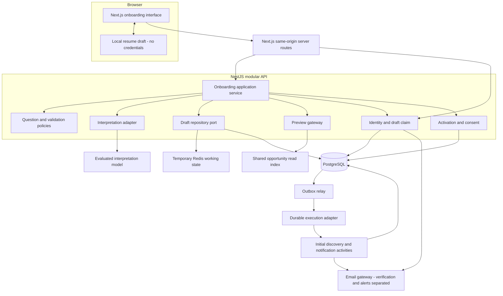
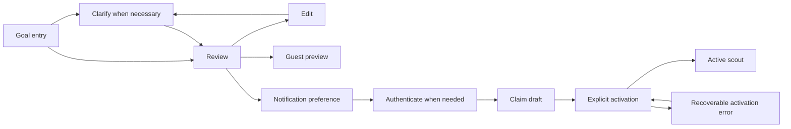

# ScoutAlert — Onboarding Architecture

**Version:** 0.3

**Date:** 1 October 2026

**Status:** Target feature design; implemented local behavior is documented in the connected-scouting guide

**Requirements baseline:** Onboarding PRD, revision 0.3, within the [Platform PRD](../prd/scoutalert-platform-prd.md)

**Boundary:** Goal entry through guest exploration or an authenticated, activated scout. The [discovery architecture](scoutalert-discovery-architecture.md) owns adaptive search, source expansion, lead ingestion and recurring discovery.

## 1. Executive decision

Implement onboarding as **state-driven shared business modules with bounded LLM interpretation**. Use Next.js for the experience and thin same-origin server routes, NestJS as the API host, framework-independent core use cases for authoritative decisions, PostgreSQL for durable account data, Redis repositories for temporary processing state and the platform execution adapter for background work. Temporal is already integrated locally; broader production adoption retains the stack's capacity and recovery gates. This target includes interpretation/preview features beyond the current deterministic reviewed flow.

An evaluated interpretation model proposes structured facts; GPT-5.4 mini remains an initial candidate. A deterministic policy selects the next question, validates eligibility-related semantics, controls review, and authorizes activation. RAG supplies evidence for preview opportunities; it is not a mandatory step in every clarification turn.

The important output is a **confirmed, versioned search specification**, not a conversation transcript. Guest exploration and activated scouting remain different outcomes. Authentication and alert consent also remain different states. These boundaries implement PRD §§1–6.

### Architecture decisions

| Decision                | Choice                                              | Reason                                                                        |
| ----------------------- | --------------------------------------------------- | ----------------------------------------------------------------------------- |
| Service boundaries      | Shared core modules composed by API and workers     | Preserve transactional activation and reuse authoritative rules across hosts  |
| Conversation authority  | Explicit draft and domain policies                  | Do not reconstruct approved requirements from a model conversation            |
| AI responsibility       | Propose typed field updates and ambiguity hints     | Keep identity, consent, and side effects outside model authority              |
| Guest persistence       | Browser resume copy; temporary server working state | Preserve the PRD's guest-local resume behavior without trusting browser flags |
| Durable owner data      | PostgreSQL after authentication                     | Support ownership, account recovery, and cross-device drafts                  |
| Side effects            | Transactional outbox plus idempotent consumers      | Avoid losing initial discovery after a successful save                        |
| Real-time delivery      | Request/response; bounded status polling            | No WebSocket dependency for onboarding                                        |
| Orchestration framework | Plain application orchestrator initially            | LangGraph is an optional implementation adapter, not the business-state owner |

## 2. System topology



These are logical boundaries, not a requirement for separate deployments. Initially deploy `web`, `api`, and `worker` processes. The shared opportunity index can use the same PostgreSQL instance, with its own module-owned schema or tables. The API should use a read interface rather than modify ingestion tables.

Use a private API origin behind the Next.js server routes for the web deployment. Expose only the intended routes through the public edge. Workers and database ports are not publicly reachable. Secrets stay in the server environment.

Next.js Route Handlers are public endpoints and still require authentication and authorization. Durable dispatch follows the platform execution boundary rather than selecting a second onboarding-specific engine. [S1]

## 3. Responsibilities and code organization

| Module                         | Owns                                                                                 | Does not own                                               |
| ------------------------------ | ------------------------------------------------------------------------------------ | ---------------------------------------------------------- |
| Onboarding UI                  | Focused questions, typed controls, local resume, review, loading and error states    | Authoritative permissions, quota counters, consent records |
| Next.js server routes          | Same-origin HTTP, cookie transport, CSRF checks, safe response forwarding            | Database transactions, model prompts, search rules         |
| Onboarding application service | Turn orchestration, revisions, review, repository selection                          | Provider-specific model APIs                               |
| Interpretation adapter         | Model request, output parsing, timeout and usage capture                             | Account creation, activation, arbitrary field mutation     |
| Policy engine                  | Supported categories, field semantics, next-question selection, activation readiness | Rewriting evidence to force a match                        |
| Draft repository               | Guest runtime storage, signed-in storage, optimistic writes                          | User-facing policy decisions                               |
| Preview gateway                | Bounded search and evidence-backed preview                                           | Account-wide ingestion or permanent guest monitoring       |
| Identity module                | Email challenges, sessions, ownership, draft claim                                   | Opportunity-email opt-in                                   |
| Activation service             | Atomic scout creation, confirmed preferences, consent, initial-work intent           | Sending emails inside the transaction                      |
| Workers                        | Outbox dispatch, initial scan handoff, delivery gates, retention cleanup             | Reinterpreting already approved requirements silently      |

Feature locations follow the [canonical repository layout](../engineering/scoutalert-repository-layout.md):

```text
apps/web/features/onboarding/          # Experience, controls, view models
apps/web/app/api/onboarding/           # Thin browser-facing transport
apps/api/src/modules/onboarding/      # Controllers, DTOs, presenters
apps/api/src/composition/             # Client/repository/use-case bindings
apps/worker/src/activities/           # Shared-use-case activity bindings
packages/core/src/onboarding/         # Domain, application, public contract
packages/core/src/identity/
packages/core/src/profiles/
packages/core/src/scouts/
packages/adapters/src/onboarding/     # Draft repositories and interpretation adapter
packages/adapters/src/identity/
packages/adapters/src/notifications/
packages/workflows/src/scouting/      # Existing durable execution; expanded discovery follows
packages/contracts/                  # HTTP schemas/types/errors
```

Keep framework decorators, datasource clients, and provider SDK types out of core. The web app shares transport validation/rendering contracts; core business rules remain authoritative. API and workers use the same use cases. Use ordered policy rules, guard clauses, and discriminated results with no nested `if` statements.

## 4. Core data contracts

### 4.1 Search specification

The structured search consists of:

- Supported opportunity category and meaningful target scope.
- Relevant self-reported background, separated from aspirations.
- Residence, work locations, relocation, authorization, and sponsorship information as separate fields.
- Engagement type, arrangement, availability, and relevant working-hour overlap.
- Financial expectations with currency, period, and compensation basis.
- Mandatory constraints, preferences, and explicit missing-information policies.
- Schema, taxonomy, policy, and search revision identifiers.

Use normalized ownership and control columns plus schema-validated JSONB for evolving answers. Do not create a separate table for every optional question. Do not store an unvalidated model transcript as the searchable profile.

### 4.2 Answer semantics

A field has both a value state and provenance. Missing information is not just `null`:

```ts
type Answer<T> =
  | { state: "unasked" }
  | { state: "unknown" }
  | { state: "skipped" }
  | { state: "specified"; value: T };

type PreferenceAnswer<T> = Answer<T> | { state: "no_preference" };

type FieldProvenance = {
  origin: "user_text" | "user_control" | "profile" | "inference" | "default";
  confirmation: "proposed" | "user_confirmed";
  sourceTurnId: string | null;
  sourceExcerpt: string | null;
  lastChangedSearchRevision: number;
};
```

`no_preference` is valid for preferences, not factual properties such as residence. User confirmation means “the user confirmed this statement,” not employer verification, credential verification, or an immigration determination.

After a user says “I live in Nigeria,” a proposed residence can be `NG`; work authorization remains unasked unless separately supplied. A model must not derive authorization or citizenship from residence.

### 4.3 Change contracts

Model output contains typed proposals, ambiguous statements, and relevant references to the input. Field paths are allowlisted. Identity, account ownership, subscription state, approved revisions, and server budgets cannot appear as model-editable paths.

A direct structured answer updates the corresponding field through ordinary validation and does not need another model call. A free-text answer may propose updates to multiple relevant fields. An attempt to change an already confirmed requirement is shown as a change requiring approval, not silently applied.

### 4.4 Revisions

Use distinct counters:

- `revision`: every accepted draft mutation; used for optimistic concurrency.
- `searchRevision`: only changes affecting search or match explanations.
- `approvedSearchRevision`: the exact search revision approved in review.
- `notificationVersion`: changes to alert preferences or the selected opt-in choice.

Preview results reference the search revision, a canonical search hash, the background snapshot used, and source versions. Changing email time does not invalidate search evidence. Changing residence or a salary floor does. Changing alert settings still requires the final activation action to use current preferences.

An approved search hash is generated by the server from canonical validated data; it is not trusted just because the browser sends it back.

## 5. State model

Avoid one oversized status enum mixing unrelated concerns.

| Dimension          | Proposed states                                                                                                    |
| ------------------ | ------------------------------------------------------------------------------------------------------------------ |
| Search draft       | `collecting`, `clarifying`, `review_ready`, `reviewed`                                                             |
| Current processing | `idle`, `interpreting`, `failed`, `manual_fallback`                                                                |
| Preview            | `not_requested`, `pending`, `ready`, `empty`, `partial`, `failed`, `stale`                                         |
| Identity           | `guest`, `verification_pending`, `authenticated`                                                                   |
| Activation         | `not_started`, `submitting`, `active`, `failed`                                                                    |
| Initial scan       | `not_scheduled`, `pending_dispatch`, `queued`, `planning`, `running`, `succeeded`, `partial`, `failed`, `deferred` |
| Coverage           | `unchecked`, `checked_scope`, `stale`, `access_limited`, `provider_unavailable`, `budget_exhausted`                |

The API returns allowed next actions derived from these states. The UI renders them; the model does not choose navigation or permissions.

These are target dimensions, not existing API enum values. Coverage is separate from execution success: a run may complete its permitted work with important gaps. Public status explains those gaps in plain language; raw provider errors and sensitive source context remain restricted.



Authenticated users can skip verification. Preview readiness is not an activation prerequisite. The absence of matching opportunities does not invalidate an otherwise useful search.

## 6. Guest-first persistence and ownership

### Browser

Keep a resume snapshot in browser storage with a schema version and inactivity expiry. Do not store OTP codes, authentication credentials, authoritative approvals, or quota counters there. The proposed seven-day inactivity period comes from the PRD; local cleanup is enforced when the application next runs or the user discards the draft, not by a guaranteed background browser timer.

When browser persistence is unavailable, keep the current session in memory and disclose that closing it may lose the draft. A shared-device discard action clears the local copy and calls the server discard endpoint.

### Temporary server processing

Use an opaque, high-entropy guest handle in an HttpOnly cookie and a short-lived Redis working copy for interpretation, concurrency, and preview operations. This is temporary processing, not a registered account. A proposed runtime TTL is 30 minutes of inactivity; this is a new architecture parameter requiring approval, not an existing PRD requirement.

A returning browser can restore its local answers into a new temporary session. The server validates them again and requires renewed review where the trusted reviewed snapshot is no longer available. Browser-supplied `verified`, `consented`, or `approved` flags have no authority.

Quotas are not restored from the browser. Apply multi-layer limits across the current session, pseudonymous guest identifier, destination when present, network, and total service budget. Resetting a session alone must not buy unlimited model calls. Avoid overly aggressive IP-only restrictions that penalize shared networks.

### After authentication

Create or find the account only through verified identity. Claim the guest draft using both the authenticated session and proof that this browser owns the guest session. Never claim a draft from a supplied email address or draft ID alone.

Copy a validated draft snapshot into PostgreSQL with a globally unique `source_guest_draft_id`; repeated claims return the same claimed draft only to the same authenticated owner. Freeze the source revision while claiming, and reject late guest writes. A failed Redis cleanup after the database insert must not produce another durable draft. The database claim record is authoritative on retry; the retired guest handle cannot access the signed-in record.

Clear the guest-local copy after confirmed handoff unless the user explicitly retains a local convenience copy. Signed-in unfinished drafts use the PRD's proposed 30-day expiry. Guest expiry never deletes an activated scout.

This design preserves the PRD distinction between browser-local guest resumption and temporary server processing. Privacy copy should explicitly disclose that submitted input is processed by the service and its model provider.

## 7. Interpretation and question selection

### Turn processing

```text
Receive requestId + expectedRevision + user input
    -> authorize guest/account session
    -> enforce size, rate, token, and request budgets
    -> record turn intent / expected revision
    -> structured answer: validate without LLM
    -> free-text answer: call interpretation adapter
    -> validate response schema and field semantics
    -> apply only allowed proposals
    -> compare-and-set against original revision
    -> select next question or review in code
    -> return canonical draft, allowed actions, and status
```

Do not hold a PostgreSQL transaction or Redis ownership lock while waiting for the LLM. Record the base revision, make the remote call outside the lock, and apply the result only if that revision and request are still current. Obsolete work can still incur cost, but must not overwrite newer answers.

Within a session, a repeated request ID with the same payload returns the same result when available. Reusing it with a different payload is rejected. Multiple tabs use optimistic conflicts instead of last-write-wins. Return `409 STALE_DRAFT` with the current revision and an appropriate refresh path.

### Question policy

Use a versioned category schema, a question catalog with stable IDs, and ordered pure rules. Conceptually:

1. Handle unsupported or multiple independent goals.
2. Obtain meaningful search scope.
3. Resolve contradictory active constraints.
4. Ask consequential unanswered fields when they materially improve the first search.
5. Offer optional refinement while within the question budget.
6. Proceed to review with visible unknowns.

These are priority rules, not six compulsory screens. Unknown facts can remain unknown; unresolved contradictory active constraints cannot be silently accepted. After the normal question budget, offer review and optional manual correction. A blocking contradiction can be resolved by explicitly changing or removing the relevant constraint, not by ignoring the limit indefinitely.

Use approved question templates and typed controls where possible. The model can identify ambiguous language, but the policy determines whether to ask, what fields an answer may update, and whether activation is valid.

### Model configuration

Evaluate `gpt-5.4-mini` behind `InterpretationPort`, then pin the selected model snapshot and task settings. The current documentation supports Structured Outputs and multiple reasoning settings. Compare `none` and `low` on onboarding fixtures; the broader stack selects production task profiles from measured quality/cost/latency. [S3]

Use the Responses API with structured output and a shared schema. Treat refusal, incomplete output, unsupported values, and provider errors as distinct cases. Correct schema shape does not establish factual accuracy. [S4]

The PRD proposes at most six model requests in an ordinary session, including at most one schema-repair attempt, a 20-second per-turn deadline, and recovery controls after ten seconds. Count all generative calls, including optional preview explanations, against the session budget. Count embedding calls separately in cost telemetry. All retries must fit within the current deadline and remaining budget; a hidden SDK retry must not bypass either.

The interpretation adapter has no email, authentication, database-admin, application-submission, or unrestricted web tools. Prefer foreground requests and supply the compact draft plus relevant user text rather than a perpetually growing provider conversation. Configure `store: false` where appropriate, but do not describe this as guaranteed zero provider retention: application state and abuse-monitoring controls are distinct. [S9]

## 8. RAG and opportunity preview

Preview calls the shared discovery read interface:

```text
Reviewed or reviewable search specification
    -> structured candidate filters and unknown policies
    -> keyword / semantic retrieval in existing opportunity index
    -> deterministic eligibility assessment
    -> evidence selection
    -> optional mini explanation
    -> up to three preview cards
```

The index may use PostgreSQL full-text search and pgvector as already proposed for the broader platform. Onboarding does not need a separate vector store or embeddings of every conversation turn.

The preview's `OpportunityPreviewPort` accepts a versioned, server-validated search specification, not arbitrary user SQL or a model-generated query. Candidate filtering must preserve the explicitly selected handling of uncertain eligibility; unknown geography is not evidence of eligibility.

Return source identifiers and evidence passages selected from the actual retrieval set. Validate every model-supplied evidence reference against that set. Links and check times come from source records, not from generated prose.

Use a scoped cache key containing the actor scope, canonical search hash, relevant background version, index/source freshness version, and evaluation version. Do not share personalized explanations across users. Public opportunity facts may be shared.

Preview requests are asynchronous when necessary: return `202` with a scoped operation ID, then poll a bounded status endpoint. The user can continue reviewing while the preview runs. An empty index should produce a truthful coverage state, not fabricated results or a blocking worldwide crawl.

A pending preview is finite on-demand work. It does not authorize recurring guest discovery. Late previews for older search revisions are discarded or displayed as stale, never as current matches.

## 9. Authentication, verification, and consent

Use a dedicated identity module or provider adapter. Keep the same identity implementation for the eventual dashboard. Do not build a second auth system inside the onboarding agent.

The current PRD proposes six-digit, single-use email codes, ten-minute expiry, a 60-second resend cooldown, and five failed attempts per challenge. Supplement this with destination and network limits, neutral account-existence responses, and atomic attempt/consume operations.

For an in-house challenge adapter, store a server-keyed code digest, not plaintext or only a fast unkeyed hash of a small code space. Bind challenges to purpose, recipient, initiating browser, and challenge generation. Supersede an earlier challenge in the same flow on resend; prevent out-of-order delivery from making the UI misleading. If verification sending is queued, any recoverable send payload containing a code must be encrypted, access-limited, short-lived, and removed on expiry; never log it.

These controls follow the general secure-code principles of cryptographic generation, secure storage, expiry, single use, neutral responses, and abuse limits. OWASP's cited code guidance is a password-reset reference, not a complete passwordless-login implementation specification. [S6]

Use secure, HttpOnly, host-only cookies and rotate the authenticated session identifier after verification. Add CSRF validation and origin checks on state-changing browser routes. SameSite is defense in depth, not the only CSRF control. HttpOnly prevents script access to the cookie, not all effects of XSS. [S5]

Authentication proves access to an inbox; it does not verify professional qualifications or immigration status.

Record opportunity-email consent separately with purpose, subject, scope, disclosure version, server timestamp, grant/withdraw action, and request reference. Selecting dashboard-only is not unsubscribe consent to a different scout and must not mutate unrelated subscriptions. A future global unsubscribe has its own explicit scope.

Verification emails are transactional authentication messages and do not require opportunity-alert opt-in. Opportunity digests require current opt-in. Never send the verification code or the email address to the interpretation model.

## 10. Activation transaction and downstream handoff

### Discovery plan handoff

The approved specification is the authority for planning. Persist the Scout and unique initial-discovery intent atomically; pass IDs and revisions through the outbox to the existing execution boundary. A discovery use case loads current state and creates/reuses a versioned plan. Do not run a model, web search, crawl or native social request inside activation's database transaction or HTTP response lifetime.

Planner and discovery outputs cannot silently edit the approved brief. An edit/pause invalidates incompatible private work through current-state publication checks. Shared public collection can continue for other Scouts. Provider availability is not a requirement to preserve a valid saved goal; subsequent work exposes partial, deferred or access-limited coverage.

The Scout Planner, Deep Discovery Agent, Evidence Research Agent and Source Expansion Agent are downstream platform responsibilities. Onboarding does not construct a personal four-agent swarm or require people to select providers. Only minimized search intent can leave the private boundary under the task's disclosure policy.

### Atomic activation

Activation requires an authenticated, claimed draft and a current reviewed search. The request includes `expectedRevision`, `approvedSearchRevision`, notification version, the explicit selected consent action where applicable, and an `Idempotency-Key`.

The activation service derives ownership from the session. It validates category availability, schema, meaningful goal, contradictions, mandatory-field policies, scheduling fields, and that the submitted review matches the current draft. Missing optional facts and an empty/failed preview are not automatic blockers.

### Atomic database work

```text
BEGIN
  Lock the claimed draft row
  Resolve existing activation / idempotency record
  Validate current revision and approved search
  Persist only approved reusable profile changes
  Create the scout from the approved search snapshot
  Persist notification preferences
  Persist explicit applicable alert-consent event
  Persist initial-scan record as pending_dispatch
  Persist scout.activated outbox event
  Store activation result and mark draft consumed
COMMIT
```

No LLM, Redis publish, provider email, or remote fetch occurs inside this database transaction. PostgreSQL row locking can serialize competing activation attempts; use a consistent lock order and bounded retry for transaction-level failures. [S7]

Proposed uniqueness controls:

```text
claimed_drafts:       UNIQUE(source_guest_draft_id)
scouts:           UNIQUE(source_onboarding_draft_id)
activation_requests: UNIQUE(user_id, idempotency_key)
activation_requests: UNIQUE(onboarding_draft_id)
scout_runs:          UNIQUE(scout_id, run_key)
notification_deliveries: UNIQUE(recipient_id, channel, logical_delivery_key)
notification_items:      UNIQUE(delivery_id, opportunity_identity, alert_reason_key)
```

The same key with a different request fingerprint returns a conflict. A new key on a consumed draft cannot create another scout. Ordinary later scout creation uses a new draft or an explicit duplication flow, not a replay of onboarding.

Delivery keys identify actual recipient/channel messages across Scouts. A digest window is recipient-scoped; contributing Scout and recommendation versions are included-item references, not separate permissions to send another digest. Preserve meaningful variant identity and coordinate item-level deduplication with prompt alerts. The platform notification module owns these rules.

For existing profiles, update only separately approved reusable fields with a profile-version check. A scout-only preference must not rewrite the shared profile. If profile facts changed on another device, surface the conflict; do not discard either version silently.

### Outbox relay

A relay leases pending outbox rows, commits its claim, submits work through the execution adapter, and records dispatch. A crash after submission but before acknowledgement may lead to duplicate dispatch. Use stable event/run identifiers plus database uniqueness and idempotent consumers. Reads, activation/idempotency records, consent, and outbox writes participate through explicitly transaction-bound repositories.

The preferred workflow engine handles multi-step retry/timer progress; activities still protect their business effects. If BullMQ is retained for an explicit responsibility, its custom job-ID deduplication ends when the old job is removed, so queue IDs cannot be the permanent business safeguard. [S8a][S8b][S11]

The initial-discovery worker accepts scout ID and version, loads the approved search, checks current active status, and records its run. It does not parse the onboarding chat again. A paused or superseded scout can prevent outdated work from executing.

A reconciliation task finds durable runs that remain `pending_dispatch` or lack valid execution progress and safely resubmits their logical intent. The user sees `pending_dispatch`, `queued`, `running`, `succeeded`, or `failed` accurately. Database commit means “scout saved,” not “a successful scan completed.”

### Scheduling and email

Discovery cadence is separate from notification cadence. Dashboard-only Scouts still run discovery. Users can receive eligible daily/weekly digests and optional prompt alerts, material-change alerts, or reminders under the platform policy. Advanced controls can be configured after initial onboarding without reducing platform capability.

Store an IANA timezone and local time for email scheduling; derive the next UTC occurrence server-side. Specify daylight-saving behavior in tests: a proposed policy is first valid local instant after a skipped time and one send during repeated local time. This is a product scheduling decision, not a promise made by a generic cron expression.

Before an opportunity email is submitted, check current account/email verification, consent, scout preferences, suppression state, and delivery ledger. Use provider idempotency where available. A queued digest becomes ineligible after opt-out. A message already accepted by a provider generally cannot be recalled; record that boundary honestly and reconcile ambiguous provider responses instead of blindly resending.

The architecture aims for effectively-once business effects through idempotency; it does not claim universal exactly-once delivery across PostgreSQL, Redis, and an external email provider.

## 11. Proposed API surface

Paths below are browser-facing Next.js server routes; internal NestJS routes can use `/v1` with the same resource structure. These endpoints are proposals, not existing repository endpoints.

| Method and path                                        | Purpose                                                                         | Authority                                     |
| ------------------------------------------------------ | ------------------------------------------------------------------------------- | --------------------------------------------- |
| `POST /api/onboarding/sessions`                        | Create temporary or signed-in draft; optionally restore validated local answers | Guest or authenticated session                |
| `GET /api/onboarding/sessions/:id`                     | Canonical current draft and allowed actions                                     | Owning session                                |
| `POST /api/onboarding/sessions/:id/turns`              | Interpret free text using request ID and expected revision                      | Owning session, bounded AI quota              |
| `PATCH /api/onboarding/sessions/:id/answers`           | Apply typed answers or reviewed corrections without mandatory LLM call          | Owning session, current revision              |
| `POST /api/onboarding/sessions/:id/review`             | Record review of current search hash/revision                                   | Owning session                                |
| `POST /api/onboarding/sessions/:id/previews`           | Start a finite preview for current search                                       | Owning session, bounded quota                 |
| `GET /api/onboarding/sessions/:id/previews/:previewId` | Read preview status/results                                                     | Owning session; revision-bound                |
| `PATCH /api/onboarding/sessions/:id/notifications`     | Edit proposed frequency, time, timezone, and alert choice                       | Owning session; does not itself send email    |
| `POST /api/auth/email-challenges`                      | Start account-access verification                                               | Rate-limited browser flow                     |
| `POST /api/auth/email-challenges/:id/verify`           | Consume challenge and establish authenticated session                           | Bound challenge and browser                   |
| `POST /api/onboarding/sessions/:id/claim`              | Associate owned guest draft with authenticated user                             | Authenticated plus guest ownership proof      |
| `POST /api/onboarding/sessions/:id/activate`           | Atomically create scout and initial-work intent                                 | Authenticated, approved revision, idempotency |
| `DELETE /api/onboarding/sessions/:id`                  | Discard unfinished draft and cancel applicable transient work                   | Owning session; not deletion of active scout  |
| `GET /api/scouts/:id/initial-scan`                     | Read saved-scout and initial-run state                                          | Authenticated owner                           |

All mutation request bodies are strict schemas. Ownership comes from trusted authentication, not request body fields. Reject mass assignment to `ownerId`, server budgets, verified flags, or active state. Guest write operations require guest session proof and CSRF protections, not just knowledge of a UUID.

Useful error codes are `INVALID_INPUT`, `UNSUPPORTED_CATEGORY`, `STALE_DRAFT`, `CLARIFICATION_REQUIRED`, `INTERPRETATION_UNAVAILABLE`, `BUDGET_EXHAUSTED`, `OTP_INVALID_OR_EXPIRED`, `RATE_LIMITED`, `REVIEW_REQUIRED`, and `IDEMPOTENCY_CONFLICT`. Use appropriate HTTP statuses and safe messages. Return retry timing for rate limits without exposing internal credentials or account existence.

## 12. Storage model

| Store / table                                   | Main contents                                                                                        |
| ----------------------------------------------- | ---------------------------------------------------------------------------------------------------- |
| Browser resume snapshot                         | User-entered goal, current answers, last displayed stage, schema version, expiry                     |
| Temporary Redis draft                           | Server-issued ID, guest binding, revisions, structured state, short-lived processing results         |
| Redis limits                                    | Guest/account/network/destination counters, request reservations, leases                             |
| `users`, `auth_sessions`                        | Verified identity, hashed opaque sessions, expiry, revocation                                        |
| `email_verification_challenges`                 | Recipient binding, keyed code digest, generation, attempts, expiry, consumption                      |
| `onboarding_drafts`                             | Authenticated owner, source guest ID, revisions, search JSONB, provenance, approved revision, expiry |
| `profiles`                                      | Confirmed reusable self-reported information and profile version                                     |
| `scouts`                                        | Approved search snapshot, version, active state, next discovery time                                 |
| `notification_preferences`                      | Scout scope, channel/frequency, local time, timezone, version                                        |
| `consent_events`                                | Purpose, scope, action, disclosure version, timestamp, request association                           |
| `activation_requests`                           | Owner/key, request fingerprint, draft ID, stable activation response                                 |
| `outbox_events`                                 | Event ID/type, aggregate/version, minimal payload, lease, publication state                          |
| `scout_runs`                                    | Durable logical execution identity, business run state, engine references                            |
| `notification_deliveries`, `notification_items` | Recipient/channel delivery identity, included items/Scout references, submission/outcome state       |
| AI telemetry                                    | Model/prompt/schema versions, duration, usage, error class; no raw private text by default           |

Use indexes on owner/draft IDs, expiry, due schedules, pending outbox work, and stable run keys. The default design is ordinary relational data plus targeted JSONB, not full event sourcing. Retain enough provenance to explain an extraction without retaining every token indefinitely.

Execution payloads contain IDs and versions, not full private profiles. Redis guest/runtime/cache state is distinct from authoritative business records and engine history. If a retained queue uses Redis, separate its persistence/non-eviction requirements from disposable cache policy. PostgreSQL remains the source of truth for activated Scouts and consent.

## 13. Security and privacy controls

Every private read and mutation is owner-scoped. Next.js server routes never pass a browser-provided identity header through as trusted. Internal service authentication and user authorization are distinct.

Use strict request bounds, appropriate encoding, a restrictive content security policy, safe text rendering, CSRF/origin checks, high-entropy session handles, session rotation, and rate limits. Do not enable arbitrary server-side URL fetching from the onboarding interpreter; the preview gateway uses approved indexed source IDs.

Keep secrets in server-side secret management. Restrict and audit operational access to account data. Do not expose keys or write-capable model tools to the browser. Separate production and evaluation projects/credentials.

Redact email addresses, OTPs, goal text, full profile data, and provider payloads from default logs, traces, error tracking, and analytics. Disable unsanitized session replay on onboarding. Debug samples require an explicit restricted retention/access policy. Model-provider data controls and regional processing choices require deployment review. `store: false` alone is not a zero-retention guarantee. [S9]

On discard or expiry, remove working content, not the minimum separate abuse-control metadata needed under the approved retention policy. Explain retention differences rather than claiming immediate deletion of every security record or queued provider message.

## 14. Reliability, testing, and observability

### Failure behavior

| Failure                                    | Expected behavior                                                                           |
| ------------------------------------------ | ------------------------------------------------------------------------------------------- |
| Model timeout, refusal, malformed output   | Preserve state; bounded retry where appropriate; manual fallback                            |
| Stale model or preview response            | Do not overwrite or present it as current; return latest revision                           |
| Temporary guest runtime lost               | Restore local answers through validation; no restored security privileges                   |
| Browser storage blocked                    | Current session remains usable; persistence limitation shown                                |
| Preview index unavailable or empty         | Honest failure/coverage state; search review and activation stay available                  |
| Email provider unavailable                 | Preserve reviewed draft; show verification delivery problem without claiming inbox delivery |
| Concurrent verification attempts           | At most one challenge consumption; attempts increment atomically                            |
| Activation response lost                   | Retry returns persisted activation result                                                   |
| Redis unavailable after activation commit  | Saved scout remains; outbox/reconciliation dispatch later                                   |
| Relay or worker processes same event twice | Stable run key prevents duplicate business effects                                          |
| User withdraws consent during queue wait   | Delivery gate suppresses opportunity email                                                  |
| Returning user has newer profile data      | Explicit merge/review; no silent profile overwrite                                          |

### Test layers

**Unit and policy tests:** semantic differences among unknown/skipped/no preference, mandatory versus preferred constraints, no residence-to-authorization inference, question ordering, contradiction handling, review invalidation, manual fallback, and supported-category rules.

**Model evaluations:** human-labeled inputs spanning professions, locations, languages in scope, vague and detailed goals, negative constraints, currency units, multiple goals, and injected instructions. Track extraction precision/recall by field, invented values, silent constraint changes, valid references, calls, tokens, and latency. Schema validity alone is insufficient.

**Integration tests:** real PostgreSQL and Redis for optimistic revisions, guest claim crash windows, OTP expiry/consumption, transaction rollback, duplicate keys, outbox restart, lost queue jobs, and consent changes. Do not rely solely on mocks for concurrency tests.

**End-to-end tests:** guest and authenticated routes; daily/weekly/dashboard-only; keyboard/mobile layouts; session expiry; multi-tab edits; back/reload; missing matches; unsupported category; repeated activation; signed-in new scout. Test daylight-saving schedule boundaries for zones that use them.

### Metrics and traces

Correlate requests through Next.js server routes, API, model adapter, preview, activation, and worker using opaque IDs. Include draft/search revision and deployed policy/model/schema version, not raw private text.

Measure clarification interactions, completion/abandonment, actual model usage, interpretation latency, schema/semantic errors, preview usefulness, verification latency, activation success, outbox lag, initial-scan completion, and suppressed/duplicate delivery attempts. Review behavior by supported category and source coverage without unnecessary fine-grained anonymous location tracking.

The PRD's three-minute median active completion time, eight-second interpretation p95, six-call budget, and 95% field-extraction target are proposed targets, not measured achievements. Critical authorization, consent, and constraint-preservation regressions block release even if an aggregate accuracy target passes.

## 15. Implementation sequence

1. **Contracts and deterministic flow:** Category schema, answer/provenance model, question catalog, state transitions, manual goal-to-review experience, local resume, and tests. No live LLM dependency.
2. **Bounded interpretation:** GPT-5.4 mini adapter, strict proposals, version checks, per-turn/session budgets, failure paths, and evaluation fixtures.
3. **Preview integration:** Read-only shared opportunity index, evidence references, stale-result handling, empty/partial states, and guest quotas.
4. **Identity and claim:** Passwordless adapter, session rotation, code abuse controls, secure guest-to-account handoff, signed-in draft resume.
5. **Activation and reliability:** Transactional scout creation, explicit consent, outbox, idempotent initial scan, status endpoint, and delivery gate tests.
6. **Operational release:** Redaction, accessibility and concurrency testing, telemetry, retention cleanup, capacity testing, and rollout controls.

An onboarding feature slice demonstrates **natural-language goal → validated draft → relevant question → editable review → guest preview**. It is not the complete product milestone. The platform's next discovery milestone demonstrates an unconfigured public source, native social discovery, informal leads, continuous exploration, source expansion, evidence-backed assessment, eligible delivery and fault recovery under the [DACC gates](../engineering/scoutalert-discovery-acceptance.md).

## 16. Deferred complexity and approval points

Do not require microservices, Kubernetes, a multi-agent team, a permanent model thread per user, a separate vector database for conversations, or CV ingestion to complete the first onboarding release.

LangGraph can mix deterministic and agentic steps and provides persistence capabilities. It can be adopted behind the interpretation/research boundary if longer workflows justify it, but its checkpoints must not replace authoritative ownership, consent, review, or activation records. Do not persist duplicate full drafts in both a graph checkpoint and the domain store without a defined authority. [S10]

Approve the proposed temporary guest-runtime TTL, concrete identity provider/library, interface languages, category coverage, preview rate limits, retention details, email scheduling defaults, and measured capacity/cost targets before production. These are not reasons to delay the core domain implementation.

**Final boundary:** The AI helps the user describe a search. The application decides what is valid, what was approved, who owns it, and which actions may run.

## References

- [Internet Discovery Architecture](scoutalert-discovery-architecture.md)
- [Delivery Roadmap and Current Status](../engineering/scoutalert-delivery-roadmap.md)
- [Connected Onboarding and Scouting](../engineering/scoutalert-connected-onboarding.md)

**Product requirements:** [Platform PRD](../prd/scoutalert-platform-prd.md) and the onboarding feature PRD, revision 0.3, especially §§5–8 and §10. Earlier generated proposals are design inputs, not a ceiling on product scope.

Original technical references were consulted on 28 September 2026; model and platform-execution guidance was checked again on 29 September 2026:

- [S1 — Next.js server route guidance](https://nextjs.org/docs/app/guides/backend-for-frontend): public route handlers and transport boundary.
- [S2 — NestJS Queues](https://docs.nestjs.com/techniques/queues): Redis-backed BullMQ integration.
- [S3 — OpenAI GPT-5.4 mini model](https://developers.openai.com/api/docs/models/gpt-5.4-mini): supported model features and snapshots.
- [S4 — OpenAI Structured Outputs](https://developers.openai.com/api/docs/guides/structured-outputs): schema-constrained outputs and limitations.
- [S5 — OWASP Session Management](https://cheatsheetseries.owasp.org/cheatsheets/Session_Management_Cheat_Sheet.html): cookie attributes, session renewal, and session protections.
- [S6 — OWASP Forgot Password](https://cheatsheetseries.owasp.org/cheatsheets/Forgot_Password_Cheat_Sheet.html): general secure one-time-code principles; not a complete passwordless-login specification.
- [S7 — PostgreSQL Explicit Locking](https://www.postgresql.org/docs/current/explicit-locking.html): row-level transaction locks.
- [S8a — BullMQ Idempotent Jobs](https://docs.bullmq.io/patterns/idempotent-jobs): retry-safe job effects.
- [S8b — BullMQ Job IDs](https://docs.bullmq.io/guide/jobs/job-ids): job-ID deduplication lifetime.
- [S9 — OpenAI Data Controls](https://developers.openai.com/api/docs/guides/your-data): application-state and monitoring retention distinctions.
- [S10 — LangGraph Overview](https://docs.langchain.com/oss/javascript/langgraph/overview): deterministic/agentic orchestration and persistence.
- [S11 — Temporal Activities](https://docs.temporal.io/activities): activity execution and retry-safe effects; consulted 29 September 2026.
