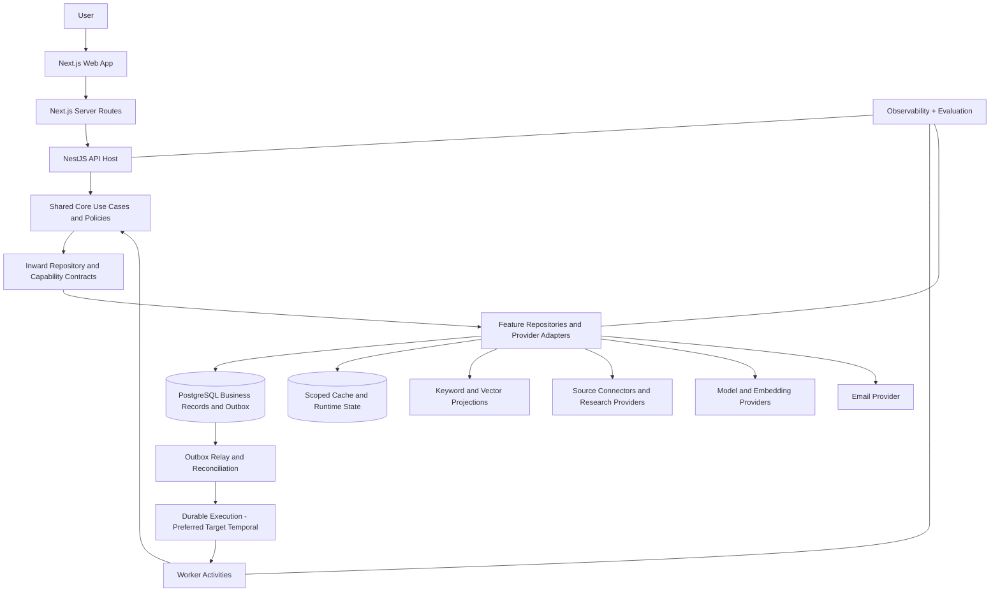
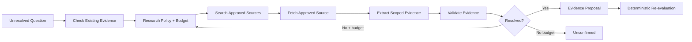

# ScoutAlert — Platform Architecture

**Version:** 0.2

**Date:** 29 September 2026

**Status:** Platform technical baseline; execution/provider adoption qualified by the stack document

**Baseline:** [Platform PRD](../prd/scoutalert-platform-prd.md); onboarding is a supporting feature

**Code layout:** [Canonical repository layout](../engineering/scoutalert-repository-layout.md)

## 1. Objective

ScoutAlert is a continuously operating opportunity intelligence platform with persistent personal Scouts. Its architecture supports employment, contracts, service opportunities, category expansion, high-quality discovery, evidence-backed matching, explicit uncertainty, reliable recurring execution, strong personalization, opportunity management, platform operations, and efficient AI use.

The core loop is:

**Understand the person → Confirm the Scout → Discover opportunities → Normalize and index evidence → Retrieve candidates → Apply deterministic constraints → Evaluate a shortlist → Research unresolved questions → Publish recommendations → Monitor changes → Notify → Pursue opportunities → Learn from feedback.**

The platform combines conventional software, hybrid retrieval, RAG, and bounded agentic research. AI interprets and investigates. Application code remains authoritative for ownership, permissions, hard constraints, consent, persistence, scheduling, idempotency, and external side effects.

## 2. Architecture principles

1. **Clean Architecture and dependency inversion.** Domain and application layers depend on abstractions, never infrastructure implementations.
2. **Repository pattern for data access.** PostgreSQL, Redis, vector search, object storage, queues, and other data sources are accessed through repositories or ports.
3. **Evidence before conclusions.** Recommendations are traceable to current source evidence and confirmed user information.
4. **Structured state over conversation history.** Confirmed, versioned search specifications are authoritative.
5. **Retrieve broadly, reason narrowly.** Structured filters and retrieval narrow the candidate set before expensive model evaluation.
6. **Shared opportunity intelligence, private matching.** Public opportunity processing is reused where source permissions allow; user-specific evaluations stay private.
7. **Explicit uncertainty.** Missing or conflicting information stays unconfirmed or conflicting until evidence resolves it.
8. **Versioned computation.** Profile, scout, opportunity, evidence, retrieval, prompt, model, and policy versions drive reuse and invalidation.
9. **Durable, idempotent execution.** Retries and duplicate dispatch are expected; logical identities, version checks, and reconciliation protect visible effects.
10. **Provider independence.** LLM, embeddings, reranking, search, email, cache, queue, and storage providers sit behind ScoutAlert-owned ports.
11. **Observability is part of correctness.** We must explain why a recommendation appeared and what produced it.
12. **Evolution-ready boundaries.** ScoutAlert can progressively replace provider capabilities with owned models and infrastructure.

## 3. High-level topology



Initial product hosts are **web**, **api**, and **worker**, alongside the existing documentation application. Worker roles can run as separately scaled processes/pools while sharing core contracts. Temporal is the preferred execution target, subject to the stack document's recovery, deployment, capacity, and operating-cost checks. It is not installed by this specification.

The diagram shows runtime responsibilities, not permission for use cases to import clients. Framework-independent business modules live in `packages/core`; repositories and provider implementations live in `packages/adapters`. Workflow definitions live in `packages/workflows` when introduced. Composition roots in apps construct and bind dependencies.

## 4. Core modules

| Module          | Responsibility                                                                      |
| --------------- | ----------------------------------------------------------------------------------- |
| Identity        | Accounts, sessions, verification, authorization                                     |
| Onboarding      | Goal interpretation, adaptive questions, review, guest-to-account handoff           |
| Profiles        | Confirmed reusable experience, skills, qualifications, provenance                   |
| Scouts          | Persistent goals, approved search specifications, policies, revisions, lifecycle    |
| Sources         | Connector configuration, permissions, cursors, health                               |
| Opportunities   | Canonical opportunities, variants, source postings, status                          |
| Evidence        | Claims, supporting passages, provenance, scope, freshness, conflicts                |
| Retrieval       | Structured filtering, keyword search, vector search, fusion                         |
| Matching        | Eligibility, compensation, professional fit, publication decisions                  |
| Research        | Bounded investigation of consequential unknowns                                     |
| Recommendations | Durable personalized recommendations and explanations                               |
| Feedback        | Saves, dismissals, reasons, preference signals                                      |
| Applications    | Employment application stages, saved snapshots, private notes, assistance requests  |
| Engagements     | Service/client leads, deliverables, budgets, engagement stages, private notes       |
| Notifications   | Consent, prompt/digest/change/reminder policy, schedules, grouping, delivery ledger |
| Integrations    | User/provider connections, permissions, lifecycle, health                           |
| Entitlements    | Plan capabilities, usage limits, reservations, feature availability                 |
| Billing         | Subscription/payment-provider event interpretation and reconciliation               |
| Operations      | Outbox, run state, quotas, reconciliation, retention, telemetry                     |

Modules communicate through application ports, explicit contracts, and domain events. One module does not modify another module's persistence directly.

A Scout references the relevant confirmed profile and approved specification/policy revisions. Runs, research cases, recommendations, applications, engagements, and deliveries are separate aggregates or records. Learned preferences cannot mutate confirmed facts or mandatory constraints. Category-specific opportunity terms distinguish employment, client work, and future categories.

## 5. Opportunity ingestion and evidence

The ingestion system builds a reusable, versioned knowledge layer.

```text
Source due
 → Fetch according to source policy
 → Validate response completeness
 → Detect meaningful change
 → Parse structured fields
 → Extract unresolved fields from text
 → Normalize taxonomy and units
 → Resolve canonical opportunity + variant
 → Store source version + evidence
 → Update keyword/vector indexes
 → Emit opportunity.changed
```

Important rules:

- Prefer structured feeds where available.
- Preserve raw source identity separately from normalized opportunity identity.
- First discovery time is not the source publication date.
- A reachable posting does not automatically prove that applications remain open.
- Failed or incomplete source responses do not automatically close missing jobs.
- Deduplication preserves materially different locations, arrangements, compensation, and legal entities.
- Every important normalized claim retains provenance.
- Source corrections create new versions and invalidate dependent assessments.
- Source refresh is independent of personal Scout runs; one accepted public version can serve many Scouts.
- Source configuration records coverage, cadence, completeness, cursor, connector version, access/reuse policy, and operational health.
- Refresh policy can adapt to observed change rate, known deadlines, relevant Scout demand, source health, and available capacity within source access/rate limits and configured freshness bounds. Shared source synchronization remains separate from individual Scout execution.
- Client/service opportunities preserve project scope, deliverables, budget basis, duration, and engagement terms rather than mapping them into job salary fields.

An evidence claim records its type, normalized value, source version, supporting passage or structured field, scope, extraction method/version, check time, validation state, conflicts, and reuse/access scope.

General employer guidance cannot silently override a more specific role restriction. Conflicts remain explicit.

## 6. Retrieval architecture

ScoutAlert uses hybrid retrieval.

```text
SearchSpecification
   ↓
Structured candidate gates
   ↓
Keyword retrieval + Semantic/vector retrieval
   ↓
Fusion
   ↓
Optional reranking
   ↓
Candidate shortlist
```

Structured gates handle known constraints such as opportunity type, current status, work arrangement, explicit location restrictions, deadline, and structured credentials.

Full-text search preserves exact domain terminology. Embeddings capture semantic relationships where wording differs.

PostgreSQL full-text search uses its native ranking functions initially; BM25 is a separate implementation choice. Evaluate query decomposition, multiple responsibility/skill/domain representations, fusion, and reranking against the simpler baseline. More representations are justified by measured recall and total downstream cost, not assumed improvement.

Vector similarity never determines legal eligibility, salary compliance, authorization, or other hard requirements on its own.

Candidate counts, fusion weights, index strategies, and reranking thresholds are evaluation-driven configuration.

Unknown structured fields retain a candidate path according to the Scout's uncertainty policy. Benchmark filtered approximate retrieval against an exact/reference path to detect false exclusions. Search is an independently rebuildable projection behind a search-index port, not the durable authority for current opportunity status or eligibility.

## 7. Matching architecture

The matching engine reasons over a shortlist rather than running an LLM over every possible user/opportunity pair.

```text
Candidate
 → Validate current opportunity version
 → Apply known hard-constraint policies
 → Assess eligibility criteria
 → Assess financial compatibility
 → Evaluate professional fit from relevant evidence
 → Identify consequential unknowns
 → Research when justified
 → Re-evaluate
 → Apply publication policy
 → Persist recommendation
```

Each criterion returns one of:

- **meets stated criteria**
- **does not meet**
- **unconfirmed**
- **conflicting**

Professional fit, eligibility, compensation, work arrangement, schedule compatibility, evidence quality, freshness, and unresolved questions remain separate dimensions.

A ranking score is an internal prioritization signal, not a probability of receiving an offer.

Model/research work runs outside persistence transactions against captured input versions. The publication transaction compares the captured Scout, profile, opportunity, and relevant evidence/policy versions with current state through locked reads or conditional writes. Obsolete evaluations can remain historical but cannot become current recommendations. Apply the same current-state gate before preparing/submitting alerts.

## 8. RAG architecture

ScoutAlert uses RAG to ground model interpretation in retrieved evidence.

A fit-evaluation package contains only relevant information:

```text
Confirmed profile evidence
+ Approved scout requirements
+ Relevant opportunity responsibilities
+ Mandatory opportunity clauses
+ Eligibility evidence
+ Known conflicts
+ Source references
```

RAG performs:

1. retrieval of relevant evidence;
2. construction of a compact evidence package;
3. structured LLM evaluation;
4. evidence-reference validation;
5. persistence of supported conclusions.

Absent evidence cannot become a confirmed fact.

## 9. Agentic research

Research is reserved for consequential unresolved questions.



The research planner, search/fetch, extraction, validation, and stopping policy have explicit inward contracts. Durable multi-step execution uses the selected workflow engine. Model/tool calls execute in activities through use cases and adapters; workflow definitions do not call raw providers.

LangGraph is conditional for specialized graph-based research if it improves the workflow. It is not a mandatory dependency or a second owner of durable business/execution state. Any checkpoint authority, boundaries, and migration/recovery behavior must be defined before adoption.

Research returns evidence or an explicit unresolved result. It cannot authorize accounts, change consent, rewrite confirmed profile facts, submit applications, bypass source policy, or directly publish recommendations.

## 10. AI gateway

All model calls pass through the ScoutAlert AI gateway.

The gateway owns:

- task identity;
- provider and model routing;
- prompt/schema version;
- structured-output validation;
- reasoning effort;
- deadlines;
- token/output ceilings;
- attempt limits;
- cost reservation and reconciliation;
- privacy class;
- observability metadata.

Business modules depend on ScoutAlert interfaces such as **FitEvaluator**, **EmbeddingProvider**, **ResearchEngine**, and **Reranker**. Provider implementations remain in infrastructure.

GPT-5.4 mini remains an evaluation candidate from the earlier stack proposal. Production task profiles select provider/model snapshots, prompts, schemas, reasoning settings, budgets, and fallback policy from ScoutAlert evaluation results. Stronger-model escalation follows observable task conditions, not model self-confidence. The provider boundary supports ScoutAlert-owned models without assuming equivalent quality or zero migration work.

## 11. Efficiency and reuse

Shared source work is reused where source permissions allow:

- fetch once per meaningful version;
- normalize once;
- extract claims once;
- embed once;
- reuse valid public employer-policy research;
- maintain canonical evidence once.

User-specific fit evaluations are private and reusable only while all relevant versions remain compatible:

```text
userId
profileVersion
scoutId
searchRevision
opportunityVariantVersion
evidenceFingerprint
retrievalPolicyVersion
evaluationPolicyVersion
promptVersion
modelVersion
validUntil
```

Application caching can eliminate a model call. Prompt caching can reduce repeated provider input work when a model call is still needed. Batch processing can serve delay-tolerant backfills and evaluation workloads.

## 12. Incremental matching

ScoutAlert uses event-driven and scheduled triggers rather than recomputing the entire user/opportunity space after every change.

Triggers include:

- scout activated or changed;
- profile version changed;
- opportunity changed;
- evidence changed or revoked;
- periodic catch-up;
- explicit refresh.

A coarse candidate-subscription index can route changed opportunities to plausible scouts using safe dimensions such as role family, category, arrangement, and broad geography. Final candidate selection still uses the retrieval engine.

Broad or uncertain searches retain catch-all routing paths.

## 13. Reliability

Durable side effects use transaction-safe patterns.

```text
Database transaction
 → write domain state
 → write outbox event
COMMIT
 → outbox relay
 → durable execution adapter
 → workflow / idempotent activity
 → durable run/effect ledger
```

PostgreSQL owns business records and durable intents. The execution engine owns dispatch/retry/timer progress. Search owns a rebuildable projection; Redis owns disposable cache and bounded runtime coordination. None replaces current business ownership, consent, or revisions.

Workers use stable logical IDs and version checks. Reconciliation detects stuck or missing dispatches.

Examples of required idempotency:

- one activated onboarding draft produces one scout;
- one logical source version is accepted once;
- one recommendation version is published once;
- one logical recipient/channel delivery identity is prepared once, with ambiguous submission reconciled before retry;
- paused/superseded scouts prevent stale queued work from publishing.

Mutation reads and all participating repositories use one transaction-bound scope with a lock or expected-version check. Persist state, stable idempotency result, and outbox intent atomically. External provider calls occur after commit.

The relay can crash after dispatch and before recording acknowledgment. Dispatch and consumption therefore use durable event/run identities, not only provider job IDs. Consumers persist processed-event identity with their business effects where possible. Events carry schema version, aggregate/version, occurrence time, correlation, and minimal IDs. Define ordering per aggregate, tolerate duplicates/out-of-order events, and reconcile missed changes.

Source synchronization, enrichment/indexing, Scout matching, research, and notification preparation are distinct work units. A persistent Scout can use finite runs and schedules or a deliberately bounded entity workflow. Long histories need rollover; LLM/fetch/email activities need retry-safe identities and deadlines. Workflow changes require compatible deployment and replay testing. [Temporal continuation](https://docs.temporal.io/workflow-execution/continue-as-new), [safe deployments](https://docs.temporal.io/develop/safe-deployments), [activity idempotency](https://docs.temporal.io/activities).

## 14. Notifications

Discovery cadence and email cadence are separate.

Dashboard-only scouts still run discovery.

Delivery supports prompt alerts for highly relevant new opportunities, scheduled digests, material-change alerts, and deadline reminders. Policy controls urgency, novelty, quiet hours, user/plan volume limits, and re-alerting. Grouping coordinates all active Scouts for the same recipient.

```text
Published recommendations
 → Group by recipient and due schedule
 → Deduplicate canonical opportunities
 → Revalidate recommendation state
 → Check consent and suppressions
 → Apply freshness, novelty, urgency, quiet-hour, and volume policy
 → Persist a logical delivery and included item/Scout references
 → Render message
 → Submit through EmailProvider
 → Record provider outcome
 → Reconcile callbacks
```

No-results, partial scans, failed scans, suppressed emails, provider acceptance, and provider-reported delivery are different states.

Use a durable delivery identity such as `UNIQUE(recipient_id, channel, logical_delivery_key)`. A digest key identifies the recipient's logical schedule window across Scouts; an alert key identifies its reason and opportunity/material-change identity. Included items record canonical/variant identity, assessment version, alert reason, and contributing Scouts. Item-level suppression coordinates immediate alerts and later digests.

The delivery record retains recipient/channel, delivery kind, logical window and timezone where applicable, notification-policy version, recommendation items, Scout contributions, status, stable provider-request identity, and provider message/outcome references. Record the consent and eligibility decision versions used at submission for audit. Those historical snapshots never replace a current consent, suppression, or eligibility check before a new submission attempt.

Schedule or policy edits must not invent another send for an already accepted logical window. Recompose prepared deliveries and revalidate included items before submission. Verify/deduplicate provider callbacks. Use provider idempotency where available; an uncertain response remains ambiguous until reconciliation can establish acceptance or a safe retry. There is no universal exactly-once guarantee across a database and external email provider.

## 15. Feedback and personalization

Feedback is tied to the exact recommendation/evaluation version.

Signals include saved, dismissed, dismissal reason, applied, application stage, explicit preference correction, and explicit positive feedback.

Feedback can influence scout-scoped ranking and preferences. It does not silently rewrite confirmed profile facts or hard constraints.

A controlled exploration allocation helps avoid overly narrow self-reinforcing personalization.

Record impressions/rank positions and policy versions alongside feedback, including the user's exposure context. Clicks and applications are not automatically unbiased training labels. Curated evaluation/training data needs documented lineage, access, permitted use, and quality review.

## 16. Security, privacy, and access boundaries

- Every private repository operation is actor-scoped.
- Browser-supplied identity fields are never authorization.
- User and source content are untrusted data.
- Tool permissions are server-controlled.
- Fetching enforces host/network/protocol/redirect/content-size rules.
- Execution payloads carry IDs and versions rather than full private profiles.
- Logs/traces exclude raw CVs, OTPs, full prompts, and unnecessary personal data by default.
- Public/shared-reuse caches never contain private personalized evaluations; private cache repositories enforce actor scope and compatible input versions.
- Source access/reuse rules propagate to indexes and caches.
- Deletion and revocation propagate to private caches/checkpoints according to policy.

## 17. Observability and evaluation

For every recommendation we should be able to answer:

```text
Which scout produced it?
Which opportunity/source version was evaluated?
Which retrieval path surfaced it?
Which deterministic rules ran?
Which model/prompt/policy version evaluated fit?
Was research performed?
Which evidence supported the explanation?
Why was it published?
Why was it included in an alert?
What did the workflow cost?
```

Evaluation suites cover extraction, evidence support, retrieval Recall@K, ranking usefulness, eligibility errors, professional-fit assessment, uncertainty handling, multilingual cases, compensation units, stale listings, duplicates, research tool behavior, and end-to-end delivery.

Track false exclusions and category/geography/language cohorts as well as aggregate usefulness. Measure source-to-observation, observation-to-recommendation, eligible-recommendation-to-submission, index/dispatch lag, research escalation, cost per useful recommendation, and recovery behavior. Targets require a declared workload and owner; they are not measured achievements.

## 18. Evolution path

ScoutAlert's provider boundaries are designed to let us progressively own more of the intelligence and infrastructure layer.

Potential ScoutAlert-owned implementations include:

- domain-specific embedding models;
- proprietary rerankers;
- opportunity and eligibility classifiers;
- professional-fit models;
- source extraction models;
- fine-tuned/domain-adapted language models;
- specialized research agents;
- dedicated retrieval/index services;
- dedicated event and data infrastructure.

Each transition is benchmarked with the same ScoutAlert evaluation suites and can coexist with external providers during migration.

Replacing embeddings requires compatible representation/model/dimension metadata, re-embedding/reindexing, evaluated query/index rollout, and rollback. Stable ports do not eliminate semantic or data migration. Provider/model candidates can be compared in shadow operation before changing current recommendations.

## 19. Opportunity workspace and commercial capabilities

Saved opportunities retain source/evaluation snapshots and private notes as listings evolve. Applications own employment stages; engagements own client/service lead stages, project requirements, and proposed work. Assistance creates reviewable truthful drafts using confirmed profile facts and evidence; outbound actions have separate explicit product permissions.

Integrations own connection permissions, health, expiry, and revocation. Entitlements own usable product capabilities and limits; billing adapters translate provider events to idempotent application commands. Budget/usage reservations apply across workflow retries and independent worker pools, and are reconciled with actual provider usage.

Restricted operations/support queries expose traceable source, run, assessment, and delivery states. Corrections create new evidence/policy versions and trigger selective invalidation rather than overwriting historical conclusions.

## 20. Capacity and infrastructure adoption

Scale discovery, extraction/indexing, matching, research, and delivery independently through worker roles/task queues. Apply per-source/provider concurrency, bounded queues, fair user/plan scheduling, and backpressure. Prevent slow research or a noisy source from blocking eligible alerts.

An outbox with consumer progress/reconciliation can support initial asynchronous events. Introduce Kafka/Redpanda only when consumer fan-out, retention/replay, throughput, ordering, and operating requirements justify a durable event backbone. Temporal execution history is not the product event bus or analytics store.

Benchmark dedicated search when filtered recall, latency, query concurrency, projection freshness, or resource isolation demands it. Row count alone is not an adoption threshold. Benchmark analytical storage when historical/event queries materially interfere with transactional workloads or require different retention/query characteristics. Each adoption needs workload evidence, migration, recovery, operating cost, and rollback criteria.

## 21. Implementation and release gates

Follow the platform PRD's complete scouting loop before treating the platform as functional: live source → canonical evidence → current Scout retrieval/evaluation → bounded research where needed → durable recommendation → eligible alert → feedback.

Release checks include duplicate/out-of-order events, transaction rollback, process loss after commit/dispatch, stale Scout/profile/evidence revisions, source partial responses, cache loss, workflow recovery, ambiguous email outcomes, opt-out during waiting, and restore/reconciliation. Source coverage, enabled categories, target workloads, and measured budgets must be explicit.

## 22. Related documents

- [Platform PRD](../prd/scoutalert-platform-prd.md)
- [Repository Layout](../engineering/scoutalert-repository-layout.md)
- [Platform User Stories](../user-stories/scoutalert-platform-user-stories-v0.1.md)
- [Onboarding PRD](../prd/scoutalert-onboarding-prd-v0.1.md)
- [Onboarding Architecture](scoutalert-onboarding-architecture-v0.1.md)
- [Technology and AI Stack](scoutalert-technology-stack-v0.1.md)
- [Engineering Standards and Project Structure](../engineering/scoutalert-engineering-standards-v0.1.md)
